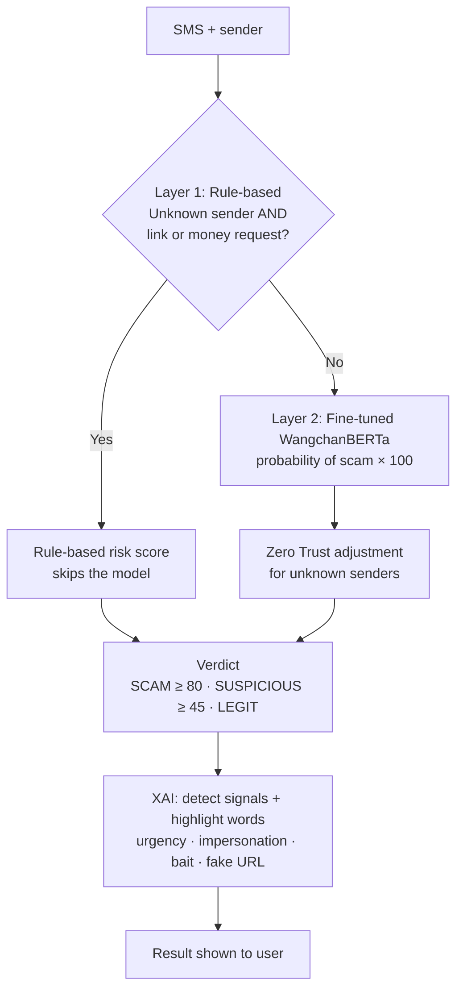

# 🛡️ CyberSense

**AI-powered Thai SMS & URL scam detection — with explanations people can understand.**
**ระบบ AI ตรวจจับ SMS และลิงก์หลอกลวงภาษาไทย พร้อมอธิบายเหตุผลให้ผู้ใช้เข้าใจ**

[English](#english) · [ภาษาไทย](#ภาษาไทย)

<!-- TODO: เพิ่ม screenshot หรือ GIF ของแอปตรงนี้ เช่น  -->

> [!NOTE]
> **Project scope — a hackathon prototype, not a production system.**
> The core features work end to end: SMS analysis, URL scanning, and explanations in a web UI running locally. It has only been tested on a small 700-message dataset, the rules are hand-written heuristics, and there is no public deployment. See [Limitations](#limitations--future-work).
>
> **ขอบเขตงาน — เป็นต้นแบบจาก Hackathon ไม่ใช่ระบบที่พร้อมใช้งานจริง**
> ฟีเจอร์หลักทำงานได้ครบตั้งแต่ต้นจนจบ ทั้งวิเคราะห์ SMS สแกนลิงก์ และอธิบายผลผ่านหน้าเว็บที่รันบนเครื่อง แต่ทดสอบกับชุดข้อมูลเพียง 700 ข้อความ กฎต่าง ๆ เขียนขึ้นเองแบบ heuristic และยังไม่ได้เปิดให้ใช้งานสาธารณะ ดู[ข้อจำกัด](#ข้อจำกัดและแผนพัฒนาต่อ)

---

## English

### The Problem

SMS scams are one of the most common forms of fraud in Thailand. Scammers impersonate banks, delivery services, and government agencies, create a sense of urgency, and send links to fake websites that steal personal and banking information. Many victims cannot tell a scam message from a real one — especially elderly people.
### What CyberSense Does

- **SMS analysis** — paste a message (and optionally the sender name) to get a risk score from 0–100 and a verdict: `SCAM`, `SUSPICIOUS`, or `LEGIT`
- **URL scanning** — check a link for short-URL hiding, domain age, brand impersonation, suspicious TLDs, credential-phishing keywords, and a blacklist
- **Explainable results** — instead of just saying "dangerous", CyberSense shows *why*: highlighted words and signals like urgency, impersonation, bait offers, and suspicious links

### How It Works



**Layer 1 — Rule-based safety net.** Scam messages from unknown senders that contain a link or ask for money are flagged immediately, without relying on the model. These cases are often unlike anything in the training data, so a fixed rule is safer than a model guess.

**Layer 2 — Deep learning model.** [WangchanBERTa](https://huggingface.co/airesearch/wangchanberta-base-att-spm-uncased), a Thai language model, fine-tuned with PyTorch and Hugging Face Transformers on a 700-message Thai SMS dataset (350 scam / 350 legitimate). The best checkpoint is chosen by **F2-score**, which weighs recall twice as much as precision — because letting a scam through is worse than a false alarm.

**XAI — Explanations.** A rule-based module detects scam signals and highlights the exact words in the message, so users learn to recognize scams themselves.

### Results

Evaluated on a held-out test set of 105 messages that the model never saw during training or model selection (70/15/15 train/validation/test split):

| Model | Accuracy | Scam recall |
|---|---|---|
| Sender name only (TF-IDF + Logistic Regression) | 80.0% | 73.1% |
| Message text (TF-IDF + Logistic Regression) | 98.1% | 98.1% |
| **CyberSense (fine-tuned WangchanBERTa)** | **100%** | **100%** |

Confusion matrix on the test set: 52/52 scams caught, 53/53 legitimate messages correctly passed, 0 errors. Full numbers: [`02_ai/results/metrics.json`](02_ai/results/metrics.json).

**What these numbers mean.** A simple TF-IDF baseline already reaches 98%, which shows the dataset is relatively easy and the test set is small. A perfect score here does **not** mean CyberSense is perfect on real-world messages. The next step is to collect more diverse, real scam messages for a harder evaluation.

### Tech Stack

| Part | Technology |
|---|---|
| AI model | WangchanBERTa, PyTorch, Hugging Face Transformers — published at [FRAMERIA/cybersense-wangchanberta](https://huggingface.co/FRAMERIA/cybersense-wangchanberta) |
| Backend | FastAPI (Python) |
| Frontend | HTML, CSS, JavaScript |
| URL checks | python-whois, rule-based scoring |

### Run Locally

Requires Python 3.11+.

```bash
python -m venv venv
venv\Scripts\activate            # Windows  (macOS/Linux: source venv/bin/activate)
pip install -r requirements.txt

# Start the server, then open http://localhost:8000
uvicorn main:app
```

The fine-tuned model is downloaded automatically from [Hugging Face Hub](https://huggingface.co/FRAMERIA/cybersense-wangchanberta) on the first request. To train it yourself instead (≈12 minutes on CPU), run `python 02_ai/train.py` — the local model in `02_ai/cybersense_model/` is used when it exists.

### API

| Method | Endpoint | Body | Returns |
|---|---|---|---|
| `POST` | `/analyze/sms` | `{"text": "...", "sender": "KBank"}` | risk, label, signals, highlights |
| `POST` | `/analyze/url` | `{"url": "kbank-verify.xyz"}` | risk, verdict, list of checks |
| `GET` | `/health` | — | server status |

### Project Structure

```
Cybersense/
├── main.py              # FastAPI server
├── url_scanner.py       # URL risk scoring
├── 02_ai/
│   ├── train.py         # Fine-tuning + evaluation
│   ├── sms_analyzer.py  # Rule-based layer + model inference
│   ├── xai.py           # Signal detection & word highlighting
│   └── results/         # Evaluation results
└── 01_frontend/
    └── index.html       # Mobile-style web UI
```

### Team & My Role

<!-- TODO: เขียนส่วนนี้เอง — ชื่อทีม, hackathon, สมาชิก, และส่วนที่เราทำเอง -->

### Limitations & Future Work

- **Small, clean dataset** — 700 messages is not enough to represent real-world scams; collect more real messages and test on them
- **Rules need maintenance** — keyword lists and brand lists must be updated as scammers change tactics
- **URL checks are heuristic** — integrate real threat-intelligence sources (e.g. Google Safe Browsing) instead of a small built-in blacklist
- **Thai only** — messages in English or mixed languages are not the focus

---

## ภาษาไทย

### ปัญหา

SMS หลอกลวงเป็นภัยไซเบอร์ที่พบบ่อยที่สุดอย่างหนึ่งในประเทศไทย มิจฉาชีพมักแอบอ้างเป็นธนาคาร บริษัทขนส่ง หรือหน่วยงานรัฐ สร้างความเร่งรีบให้เหยื่อตัดสินใจโดยไม่ทันคิด และแนบลิงก์ไปยังเว็บปลอมเพื่อขโมยข้อมูลส่วนตัวและข้อมูลบัญชีธนาคาร หลายคนแยกไม่ออกว่าข้อความไหนจริงข้อความไหนปลอม โดยเฉพาะผู้สูงอายุ
### CyberSense ทำอะไรได้บ้าง

- **วิเคราะห์ SMS** — วางข้อความ (และชื่อผู้ส่ง ถ้ามี) ระบบจะให้คะแนนความเสี่ยง 0–100 และผลตัดสิน `SCAM` (หลอกลวง), `SUSPICIOUS` (น่าสงสัย) หรือ `LEGIT` (ปลอดภัย)
- **สแกนลิงก์** — ตรวจว่าเป็นลิงก์ย่อที่ซ่อนปลายทางไหม อายุโดเมน การแอบอ้างชื่อแบรนด์ นามสกุลโดเมนที่น่าสงสัย คำที่ใช้หลอกขอข้อมูล และรายชื่อเว็บอันตราย
- **อธิบายเหตุผลได้** — ไม่ได้บอกแค่ว่า "อันตราย" แต่บอกว่า *ทำไม* โดยไฮไลต์คำในข้อความ และแสดงสัญญาณ เช่น การเร่งรีบ การแอบอ้างหน่วยงาน การล่อด้วยผลประโยชน์ และลิงก์น่าสงสัย

### หลักการทำงาน

(ดูแผนภาพในส่วน [How It Works](#how-it-works))

**ชั้นที่ 1 — Rule-based ด่านป้องกัน** ข้อความจากผู้ส่งที่ไม่รู้จักและมีลิงก์หรือขอเงิน จะถูกตัดสินทันทีโดยไม่ผ่านโมเดล เพราะข้อความลักษณะนี้มักไม่เหมือนข้อมูลที่โมเดลเคยเรียน การใช้กฎที่แน่นอนจึงปลอดภัยกว่าให้โมเดลเดา

**ชั้นที่ 2 — Deep Learning** ใช้ [WangchanBERTa](https://huggingface.co/airesearch/wangchanberta-base-att-spm-uncased) ซึ่งเป็นโมเดลภาษาไทย มา fine-tune ด้วย PyTorch และ Hugging Face Transformers บนชุดข้อมูล SMS ภาษาไทย 700 ข้อความ (หลอกลวง 350 / ปกติ 350) และเลือกโมเดลที่ดีที่สุดด้วย **F2-score** ซึ่งให้น้ำหนักกับ recall มากกว่า precision 2 เท่า เพราะการปล่อยข้อความหลอกลวงหลุดไปอันตรายกว่าการเตือนผิด

**XAI — อธิบายผล** โมดูล rule-based ตรวจหาสัญญาณหลอกลวงและไฮไลต์คำในข้อความ เพื่อให้ผู้ใช้เรียนรู้ที่จะสังเกตข้อความหลอกลวงได้เอง

### ผลการทดสอบ

ทดสอบกับข้อความ 105 ข้อความที่โมเดลไม่เคยเห็นทั้งตอนเทรนและตอนเลือกโมเดล (แบ่งข้อมูล train/validation/test เป็น 70/15/15)

| โมเดล | Accuracy | Recall (จับข้อความหลอกลวงได้) |
|---|---|---|
| ดูแค่ชื่อผู้ส่ง (TF-IDF + Logistic Regression) | 80.0% | 73.1% |
| ดูข้อความ (TF-IDF + Logistic Regression) | 98.1% | 98.1% |
| **CyberSense (WangchanBERTa ที่ fine-tune แล้ว)** | **100%** | **100%** |

จับข้อความหลอกลวงได้ครบ 52/52 และไม่เตือนผิดกับข้อความปกติเลย 53/53 ดูตัวเลขทั้งหมดได้ที่ [`02_ai/results/metrics.json`](02_ai/results/metrics.json)

**ตัวเลขนี้บอกอะไร** โมเดลพื้นฐานอย่าง TF-IDF ก็ได้ถึง 98% แล้ว แสดงว่าชุดข้อมูลยังค่อนข้างง่ายและชุดทดสอบยังเล็ก คะแนน 100% จึง**ไม่ได้**แปลว่า CyberSense จะแม่นยำ 100% กับข้อความจริง ขั้นต่อไปคือเก็บข้อความหลอกลวงจริงที่หลากหลายขึ้นมาทดสอบให้ยากขึ้น

### เทคโนโลยีที่ใช้

| ส่วน | เทคโนโลยี |
|---|---|
| โมเดล AI | WangchanBERTa, PyTorch, Hugging Face Transformers — เผยแพร่ที่ [FRAMERIA/cybersense-wangchanberta](https://huggingface.co/FRAMERIA/cybersense-wangchanberta) |
| Backend | FastAPI (Python) |
| Frontend | HTML, CSS, JavaScript |
| ตรวจลิงก์ | python-whois, ระบบให้คะแนนแบบ rule-based |

### วิธีรันบนเครื่อง

ดูขั้นตอนในส่วน [Run Locally](#run-locally) — ไม่ต้องเทรนโมเดลเอง ระบบจะดาวน์โหลดโมเดลจาก Hugging Face ให้อัตโนมัติ

### ทีมและหน้าที่ของฉัน

<!-- TODO: เขียนส่วนนี้เอง -->

### ข้อจำกัดและแผนพัฒนาต่อ

- **ชุดข้อมูลเล็กและสะอาดเกินไป** — 700 ข้อความยังไม่พอจะเป็นตัวแทนข้อความหลอกลวงจริง ควรเก็บข้อความจริงเพิ่มและทดสอบกับข้อมูลนั้น
- **กฎต้องอัปเดตตลอด** — รายการคำและชื่อแบรนด์ต้องปรับตามกลยุทธ์ใหม่ ๆ ของมิจฉาชีพ
- **การตรวจลิงก์ยังเป็น heuristic** — ควรเชื่อมกับแหล่งข้อมูลภัยคุกคามจริง (เช่น Google Safe Browsing) แทนรายชื่อเว็บอันตรายขนาดเล็กที่มีในระบบ
- **รองรับภาษาไทยเป็นหลัก** — ข้อความภาษาอังกฤษหรือหลายภาษาปนกันยังไม่ใช่จุดเน้น
